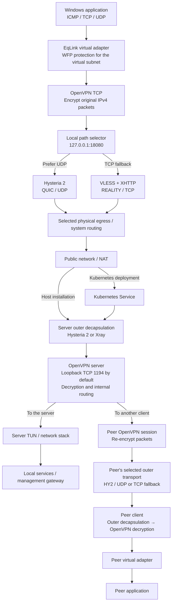

# EqLink

[English](README.md) | [简体中文](README.zh-CN.md)

EqLink provides a virtual IPv4 network with outer transports designed to resist blocking. The inner network uses **OpenVPN TCP**. In automatic mode, the outer transport prefers **Hysteria 2 / UDP** and falls back to **VLESS + XHTTP + REALITY / TCP** when the UDP connection is unavailable.

Full acceptance remains incomplete. See [validation status](docs/validation-status.md) for the scope of builds and real-network tests for each version.

## Features

- Import a universal `.eqlink` enrollment bundle to configure a connection, then enroll the device online on its first connection.
- Generate independent keys locally; the server issues separate certificates and outer credentials, with per-device revocation.
- Obtain a persistent, server-assigned address or request a static address for the server to validate.
- Select a physical egress interface and dedicated DNS to coexist with other TUN applications, including Meta.



OpenVPN encrypts application IPv4 packets before they pass through the selected outer transport. Each OpenVPN data connection uses one outer path at a time. Switching paths rebuilds the connection and may interrupt existing application sessions. Enrollment, address requests and configuration synchronization reach the server's loopback control API through the same outer transports. Only the outer TCP/UDP ports are exposed publicly.

## Server setup

The following steps are for a new deployment. When upgrading an existing installation, preserve the CA, REALITY keys, virtual subnet, device identities and persistent state, and follow the upgrade procedure in the relevant installation guide.

### Linux

1. Prepare a Debian/Ubuntu host running systemd on amd64 or arm64, with `/dev/net/tun` available.
2. Download the `eqlink-server` archive for your architecture from [Releases](https://github.com/chens32/eqlink/releases). Verify the release asset's SHA-256, extract the archive and enter the extracted directory. See the [Kubernetes installation guide](docs/kubernetes-installation.md) for download and verification examples.
3. Install the host dependencies and confirm that OpenVPN is version 2.6 or later:

   ```bash
   sudo apt-get update
   sudo apt-get install openvpn openssl iproute2 python3
   ```

   The server package includes the .NET runtime; the .NET SDK is not required. Minimal systems also need the runtime's native system libraries, including ICU.

4. Place the HY2 certificate and private key in a directory the service can read, such as `/etc/eqlink-tls`. The example configuration uses `tls.crt` and `tls.key` in that directory. In the extracted directory, prepare the REALITY keys and private settings file:

   ```bash
   chmod 0755 EqLink.Server hysteria xray
   sudo install -d -m 0700 /root/eqlink-private
   sudo sh -c 'umask 077; ./xray x25519 > /root/eqlink-private/reality-keys.txt'
   sudo install -m 0600 server-settings.example.json \
     /root/eqlink-private/server-settings.json
   sudoedit /root/eqlink-private/server-settings.json
   ```

   Set the public hostname, TCP/UDP ports, virtual subnet, HY2 certificate paths and REALITY parameters. Copy the generated `PrivateKey` and `Password (PublicKey)` values into `realityPrivateKey` and `realityPublicKey`, respectively, replacing the example values. The example uses TCP `30443`, UDP `30444` and the virtual subnet `10.88.0.0/24`.
5. Install and check the service from the extracted directory:

   ```bash
   sudo bash install-server.sh /root/eqlink-private/server-settings.json
   sudo systemctl status eqlink.service --no-pager
   sudo /usr/local/bin/eqlink-server inspect --json
   ```

   The installer creates `eqlink.service` and stores persistent state in `/etc/eqlink`. Allow or forward only the configured outer TCP/UDP ports through the firewall and router. Keep the OpenVPN, control, authentication and management loopback ports off the public network.
6. Generate a universal enrollment bundle and distribute it privately to clients:

   ```bash
   sudo /usr/local/bin/eqlink-server enrollment-create \
     --name network --bundle /root/eqlink-private/network.eqlink
   ```

   If HY2 uses a private CA, the bundle also needs the public root certificate with a fingerprint verified by the administrator. Multiple devices can enroll with the same bundle, each generating an independent identity. Anyone holding an active bundle can request a new identity, so treat it as a credential.

See [Linux server installation](docs/server-installation.md) for complete configuration, service management and handling of existing installations.

### Kubernetes deployment

This example uses k3s, an ARM64 node and `v1.0.0`. For AMD64 nodes, use the corresponding server archive, image platform and tag. The node needs an allocatable TUN device-plugin resource, a usable StorageClass/PVC and permission for the Pod to use `NET_ADMIN`.

1. Obtain the repository source and work from its root directory. Prepare Git, Python 3, curl, jq, Docker Buildx and a server archive matching the target node's architecture with its SHA-256 verified. Prefer a build host of the same architecture; cross-architecture builds also require QEMU/binfmt support.
2. Copy the server archive into the image build directory, then build and export the image. This directory should contain only the public server archive and the helper script shown below:

   ```bash
   VERSION=1.0.0
   ARCH=arm64
   IMAGE="docker.io/eqlink/server:${VERSION}-${ARCH}"
   CONTEXT="artifacts/kubernetes-image-${VERSION}-${ARCH}"
   mkdir -p "$CONTEXT"
   cp "/path/to/eqlink-server-${ARCH}-${VERSION}.tar.gz" "$CONTEXT/"
   cp packaging/k3s/device-request.py "$CONTEXT/"
   docker buildx build --load --platform "linux/$ARCH" \
     --build-arg "SERVER_ARCHIVE=eqlink-server-${ARCH}-${VERSION}.tar.gz" \
     --tag "$IMAGE" --file packaging/kubernetes/Dockerfile "$CONTEXT"
   docker save --output "artifacts/eqlink-server-${ARCH}-image.tar" "$IMAGE"
   sha256sum "artifacts/eqlink-server-${ARCH}-image.tar"
   ```

3. Transfer the image tar to the selected k3s node, verify its SHA-256 and import it into that node's containerd:

   ```bash
   sudo k3s ctr --namespace k8s.io images import /path/to/eqlink-server-arm64-image.tar
   sudo k3s crictl inspecti docker.io/eqlink/server:1.0.0-arm64
   ```

   The deployment uses `imagePullPolicy: Never`, so the image must already exist on the target node. For other Kubernetes distributions, import it into the CRI actually used by that node.
4. Generate the deployment configuration on a management machine with cluster administration access. Keep certificates, private keys and the output directory outside the repository. Use the `xray` binary from the server archive matching the management machine's architecture. Replace the node, hostname, certificate paths, StorageClass and TUN resource name with your actual values:

   ```bash
   umask 077
   mkdir -p "$HOME/eqlink-private"
   python3 packaging/k3s/deploy.py \
     --node YOUR_NODE --arch arm64 \
     --image docker.io/eqlink/server:1.0.0-arm64 \
     --namespace eqlink-test --storage-class local-path \
     --public-host vpn.example.net --tls-server-name vpn.example.net \
     --tls-cert /private/tls.crt --tls-key /private/tls.key \
     --overlay 10.88.0.0/24 --tcp-port 30443 --udp-port 30444 \
     --tun-resource example.com/tun --xray /private/tools/xray \
     --output "$HOME/eqlink-private/rendered" --render-only
   ```

5. Review the generated private configuration and confirm the node, architecture, storage and ports. Run the same command again without `--render-only` to perform cluster preflight checks and deploy. The initial deployment entry point refuses to overwrite an existing EqLink Deployment; use the [upgrade procedure](docs/kubernetes-installation.md) for existing environments.
6. Allow or forward public TCP `30443` and UDP `30444` to the fixed node hosting the Pod, or to its VIP. Keep the outer ports consistent with the configuration. Check the deployment:

   ```bash
   kubectl -n eqlink-test rollout status deployment/eqlink-server --timeout=300s
   kubectl -n eqlink-test get pods -l app=eqlink-server -o wide
   kubectl -n eqlink-test exec deployment/eqlink-server -c server -- EqLink.Server inspect --json
   ```

7. Generate the universal enrollment bundle on the management machine and distribute it privately:

   ```bash
   umask 077
   python3 packaging/k3s/devices.py enrollment-create \
     --namespace eqlink-test --name network \
     --output "$HOME/eqlink-private/network.eqlink"
   ```

   If HY2 uses a private CA, add `--hysteria-ca /private/root-ca.cer --expected-ca-sha256 VERIFIED_CA_SHA256`. Replace the fingerprint placeholder with the SHA-256 of the certificate's DER content, independently verified by the administrator.

See [Kubernetes / k3s installation](docs/kubernetes-installation.md) for complete image-building, node/TUN checks, enrollment, upgrade and rollback instructions. Once the Pod is Ready, use real clients to verify both outer transports and connectivity between virtual IPs.

## Client connection setup

### Windows

1. On Windows 10/11 x64, download the `eqlink-client` installer from [Releases](https://github.com/chens32/eqlink/releases), verify the asset's SHA-256 and run it with administrator approval. The single installer handles EqLink and the pinned official OpenVPN dependency.
2. Obtain the current v2 `.eqlink` universal enrollment bundle from your administrator and import it under **设备与诊断** (Devices and diagnostics). Importing generates a local identity and displays **已导入，待登记** (Imported, pending enrollment).
3. Run the client as an administrator when changing settings. Under **连接设置** (Connection settings) → **虚拟地址** (Virtual address), keep automatic assignment or submit a static address request. The server confirms the final address. The default device address pool is `.10`–`.254` in the selected `/24`; administrators can reserve additional addresses.
4. To coexist with another TUN application such as Meta, disconnect EqLink and open **连接设置** → **配置出口与 DNS…** (Configure egress and DNS) with administrator privileges. Select the actual physical adapter and an available dedicated IPv4 DNS server, then save before connecting. See [physical egress](docs/windows-physical-egress.md) for details.
5. Under **连接设置**, choose **自动** (Automatic), **仅 UDP** (UDP only) or **仅 TCP** (TCP only), save the mode and select **连接** (Connect). The first connection completes online enrollment, issues independent credentials and confirms the address. Once connected, use the assigned virtual IPs to reach the server and other clients.
6. To access services by hostname, save hostname-to-IPv4 mappings within the virtual subnet under **域名覆写** (Domain overrides). Settings are saved per network; see [domain overrides](docs/hosts-overrides.md).

The GUI currently uses Simplified Chinese. The same active bundle can be imported on multiple machines, each enrolling an independent identity. `identity.dpapi` is bound to the original Windows machine and cannot be copied as another machine's client configuration.

### Linux

The current official releases provide a **Windows x64 client**. Linux supports server deployment and core component builds, but a native client installer that imports `.eqlink` bundles and a complete Linux client connection procedure are not yet available. The Linux server archive does not contain a Linux client; installing it does not provide client connectivity.

The Windows WPF, WFP, TAP and DPAPI client components, together with `identity.dpapi`, cannot be moved directly to Linux. See [development](docs/development.md) and [validation status](docs/validation-status.md) for the supported development and acceptance scope.

## Build and test

Use the SDK pinned by `global.json`, Python 3.12+ and PowerShell. Dependency versions, download sources and SHA-256 values are pinned in `packaging/third_party.lock.json`.

```powershell
python tools/check-repository.py
python tools/check-release.py
dotnet run --project src/EqLink.Tests/EqLink.Tests.csproj -c Release
python packaging/k3s/test-upgrade.py
python packaging/k3s/test-migration.py
python packaging/k3s/test_bundle_trust.py
pwsh -File packaging/build-windows.ps1
pwsh -File packaging/build-server.ps1 -Arch amd64
pwsh -File packaging/build-server.ps1 -Arch arm64
```

See [development](docs/development.md) and [acceptance tools](packaging/acceptance/README.zh-CN.md) for more details.

CI covers source/history secret scanning, offline deployment checks, Windows/Linux core tests, Windows compilation and CodeQL. It does not automatically deploy a real server or run the installer/uninstaller lifecycle.

## Maintenance and licensing

[Contributing](CONTRIBUTING.md) · [Security reporting](SECURITY.md) · [Changelog](CHANGELOG.md) · [v2 protocol](docs/protocol-v2.md)

EqLink's original source is **GPL-3.0-only**; see [LICENSE](LICENSE). Third-party components retain their own licenses. Distribution obligations, including OpenVPN's GPLv2 and Xray's MPL-2.0 requirements, still apply when EqLink uses GPLv3. See [license review](docs/licensing.md).
