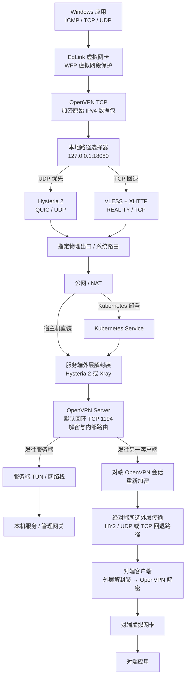

# EqLink

[English](README.md) | [简体中文](README.zh-CN.md)

EqLink 提供带抗封锁的虚拟 IPv4 网络，网络内层采用 **OpenVPN TCP**，自动模式下外层优先 **Hysteria 2 / UDP**，UDP 连接不可用时回退 **VLESS + XHTTP + REALITY / TCP**。

当前完整验收尚未完成，各版本构建与现场测试的范围见 [验收状态](docs/validation-status.md)。

## 主要功能

- 导入 `.eqlink` 通用入网包配置连接，首次连接时在线登记设备。
- 本机生成独立密钥，服务端签发各自的证书与外层凭据，支持单设备吊销。
- 服务端自动分配并持久保留地址，或验证客户端申请的静态地址。
- 指定物理出口与专用 DNS，可与 Meta 等 TUN 共存。



业务 IPv4 包先由 OpenVPN 加密，再通过选定的外层传输。同一条 OpenVPN 数据连接只使用一条外层路径；切换路径会重建连接，现有业务会话可能中断。登记、地址申请和配置同步通过相同外层访问服务端回环控制接口。公网只开放外层 TCP/UDP 端口。

## 服务端配置流程

以下用于首次部署。已有环境升级须保留 CA、REALITY 密钥、虚拟网段、设备身份和持久状态，按对应安装文档的升级流程执行。

### Linux

1. 准备 Debian/Ubuntu 主机，支持 amd64 或 arm64，使用 systemd 并具备 `/dev/net/tun`。
2. 从 [Releases](https://github.com/chens32/eqlink/releases) 下载对应架构的 `eqlink-server` 归档，核对发布附件的 SHA-256 后解压，并进入解压目录。下载与校验示例见 [Kubernetes 安装说明](docs/kubernetes-installation.zh-CN.md)。
3. 安装宿主机依赖，确认 OpenVPN 为 2.6 或更高版本：

   ```bash
   sudo apt-get update
   sudo apt-get install openvpn openssl iproute2 python3
   ```

   服务端包自带 .NET 运行时，无需安装 .NET SDK；最小化系统还需具备该运行时要求的 ICU 等原生系统库。

4. 将 HY2 证书和私钥放在 `/etc/eqlink-tls` 等服务可读目录；示例配置使用该目录下的 `tls.crt` 和 `tls.key`。在解压目录准备 REALITY 密钥和私密配置文件：

   ```bash
   chmod 0755 EqLink.Server hysteria xray
   sudo install -d -m 0700 /root/eqlink-private
   sudo sh -c 'umask 077; ./xray x25519 > /root/eqlink-private/reality-keys.txt'
   sudo install -m 0600 server-settings.example.json \
     /root/eqlink-private/server-settings.json
   sudoedit /root/eqlink-private/server-settings.json
   ```

   填写公网域名、TCP/UDP 端口、虚拟网段、HY2 证书路径及 REALITY 参数。将生成结果中的 `PrivateKey`、`Password (PublicKey)` 分别填入 `realityPrivateKey`、`realityPublicKey`，替换示例值。示例外层端口为 TCP `30443`、UDP `30444`，虚拟网段为 `10.88.0.0/24`。
5. 在解压目录安装并检查服务：

   ```bash
   sudo bash install-server.sh /root/eqlink-private/server-settings.json
   sudo systemctl status eqlink.service --no-pager
   sudo /usr/local/bin/eqlink-server inspect --json
   ```

   安装器创建 `eqlink.service`，持久状态保存在 `/etc/eqlink`。防火墙和路由器仅放行或映射配置的外层 TCP/UDP 端口，OpenVPN、控制、认证和管理回环端口不映射到公网。
6. 生成通用入网包，私密分发给客户端：

   ```bash
   sudo /usr/local/bin/eqlink-server enrollment-create \
     --name network --bundle /root/eqlink-private/network.eqlink
   ```

   HY2 使用私有 CA 时，通用包还需包含管理员核验过指纹的公有根证书。通用包可供多台设备登记，每台设备生成独立身份；持有有效入网包即可申请新身份，因此应按凭据保管。

完整配置、服务管理与既有安装处理见 [Linux 服务端安装说明](docs/server-installation.md)。

### Kubernetes 部署

以 k3s、ARM64 节点和 `v1.0.0` 为例。AMD64 节点改用对应架构的服务端包、镜像平台和标签；节点需有可分配的 TUN 设备插件资源、可用 StorageClass/PVC，并允许 Pod 使用 `NET_ADMIN`。

1. 取得仓库源码，在仓库根目录操作。准备 Git、Python 3、curl、jq、Docker Buildx，以及与目标节点架构一致且已核对 SHA-256 的服务端包。优先使用同架构构建机，跨架构构建另需 QEMU/binfmt 支持。
2. 将服务端包放入镜像构建目录，并构建、导出镜像。该目录只放公开的服务端包和下面的辅助脚本：

   ```bash
   VERSION=1.0.0
   ARCH=arm64
   IMAGE="docker.io/eqlink/server:${VERSION}-${ARCH}"
   CONTEXT="artifacts/kubernetes-image-${VERSION}-${ARCH}"
   mkdir -p "$CONTEXT"
   cp "/path/to/eqlink-server-${ARCH}-${VERSION}.tar.gz" "$CONTEXT/"
   cp packaging/k3s/device-request.py "$CONTEXT/"
   docker buildx build --load --platform "linux/$ARCH" \
     --build-arg "SERVER_ARCHIVE=eqlink-server-${ARCH}-${VERSION}.tar.gz" \
     --tag "$IMAGE" --file packaging/kubernetes/Dockerfile "$CONTEXT"
   docker save --output "artifacts/eqlink-server-${ARCH}-image.tar" "$IMAGE"
   sha256sum "artifacts/eqlink-server-${ARCH}-image.tar"
   ```

3. 将镜像 tar 传到选定的 k3s 节点，核对 SHA-256 后导入该节点的 containerd：

   ```bash
   sudo k3s ctr --namespace k8s.io images import /path/to/eqlink-server-arm64-image.tar
   sudo k3s crictl inspecti docker.io/eqlink/server:1.0.0-arm64
   ```

   部署使用 `imagePullPolicy: Never`，镜像必须已存在于目标节点。其他 Kubernetes 发行版需按该节点实际使用的 CRI 导入。
4. 在有集群管理权限的管理机生成部署配置。证书、私钥及输出目录放在仓库外；`xray` 使用管理机自身架构的服务端包内版本。将节点、域名、证书路径、StorageClass 和 TUN 资源名替换为实际值：

   ```bash
   umask 077
   mkdir -p "$HOME/eqlink-private"
   python3 packaging/k3s/deploy.py \
     --node YOUR_NODE --arch arm64 \
     --image docker.io/eqlink/server:1.0.0-arm64 \
     --namespace eqlink-test --storage-class local-path \
     --public-host vpn.example.net --tls-server-name vpn.example.net \
     --tls-cert /private/tls.crt --tls-key /private/tls.key \
     --overlay 10.88.0.0/24 --tcp-port 30443 --udp-port 30444 \
     --tun-resource example.com/tun --xray /private/tools/xray \
     --output "$HOME/eqlink-private/rendered" --render-only
   ```

5. 检查生成的私密配置，确认节点、架构、存储和端口。然后重新执行同一命令，去掉 `--render-only`，由脚本完成集群预检和部署。首次部署入口拒绝覆盖已有 EqLink Deployment；已有环境使用 [升级流程](docs/kubernetes-installation.zh-CN.md)。
6. 放行或映射公网 TCP `30443`、UDP `30444` 到 Pod 所在固定节点或其 VIP，保持外层端口与配置一致。检查运行状态：

   ```bash
   kubectl -n eqlink-test rollout status deployment/eqlink-server --timeout=300s
   kubectl -n eqlink-test get pods -l app=eqlink-server -o wide
   kubectl -n eqlink-test exec deployment/eqlink-server -c server -- EqLink.Server inspect --json
   ```

7. 在管理机生成通用入网包并私密分发：

   ```bash
   umask 077
   python3 packaging/k3s/devices.py enrollment-create \
     --namespace eqlink-test --name network \
     --output "$HOME/eqlink-private/network.eqlink"
   ```

   HY2 使用私有 CA 时，追加 `--hysteria-ca /private/root-ca.cer --expected-ca-sha256 VERIFIED_CA_SHA256`；将指纹占位符替换为管理员独立核验的证书 DER 内容 SHA-256。

镜像构建、节点/TUN 检查、通用包和升级回滚的完整说明见 [Kubernetes / k3s 安装](docs/kubernetes-installation.zh-CN.md)。Pod Ready 后仍需使用实际客户端验证两条外层及虚拟 IP 互访。

## 客户端接入流程

### Windows

1. 使用 Windows 10/11 x64，从 [Releases](https://github.com/chens32/eqlink/releases) 下载 `eqlink-client` 安装包，核对附件 SHA-256 后，以管理员权限运行。单入口安装器处理 EqLink 和固定版本的官方 OpenVPN 依赖。
2. 从管理员取得当前 v2 `.eqlink` 通用入网包，在“设备与诊断”中选择文件导入。导入后生成本机身份，显示“已导入，待登记”。
3. 需要修改设置时，以管理员身份运行客户端。在“连接设置”的“虚拟地址”中保持自动分配，或提交静态地址申请；最终地址由服务端确认。默认设备地址池为所选 `/24` 的 `.10`～`.254`，管理员可额外保留地址。
4. 如需与 Meta 等 TUN 共存，在断开状态下以管理员权限打开“连接设置”中的“配置出口与 DNS…”，选择实际物理网卡和可用的专用 IPv4 DNS，保存后再连接；具体设置见 [指定物理出口](docs/windows-physical-egress.md)。
5. 在“连接设置”中选择“自动”“仅 UDP”或“仅 TCP”，保存模式并点击“连接”。首次连接完成在线登记、独立凭据签发和地址确认；连接建立后可使用分配的虚拟 IP 访问服务端及其他客户端。
6. 需要按域名访问时，在“域名覆写”中保存虚拟网段内的域名与 IPv4 映射。设置按网络保存，详见 [域名覆写](docs/hosts-overrides.md)。

同一份有效通用包可导入多台机器，每台机器登记独立身份。`identity.dpapi` 绑定原 Windows 机器，不作为另一台机器的客户端配置复制使用。

### Linux

当前正式发行包仅提供 **Windows x64 客户端**。Linux 支持服务端部署和核心组件构建，尚未提供可直接导入 `.eqlink` 的原生客户端安装包或完整接入流程。Linux 服务端压缩包不包含 Linux 客户端，不能通过安装该包完成客户端接入。

Windows 的 WPF、WFP、TAP、DPAPI 客户端组件和 `identity.dpapi` 不能直接迁移到 Linux 运行。开发与实际验收的支持范围见 [开发环境](docs/development.md) 和 [验收状态](docs/validation-status.md)。

## 开发与构建

SDK 版本由 `global.json` 固定；另需 Python 3.12+、PowerShell。依赖版本、下载来源与 SHA-256 固定在 `packaging/third_party.lock.json`。命令见 [英文 README](README.md#build-and-test)、[开发环境](docs/development.md) 和 [验收工具](packaging/acceptance/README.zh-CN.md)。

CI 覆盖源码/历史秘密扫描、离线部署检查、Windows/Linux 核心测试、Windows 编译和 CodeQL；不自动部署真实服务端或运行安装卸载。

## 维护与许可证

[贡献指南](CONTRIBUTING.md) · [安全报告](SECURITY.md) · [变更记录](CHANGELOG.md) · [v2 协议](docs/protocol-v2.md)

EqLink 原创源码使用 **GPL-3.0-only**，见 [LICENSE](LICENSE)。第三方组件保留原许可，OpenVPN 的 GPLv2、Xray 的 MPL-2.0 等分发义务不因 EqLink 采用 GPLv3 而取消。[许可审查](docs/licensing.md)。
